# 基于微信小程序的周边美食推荐系统2axo8

> 🎓 **计算机毕业设计 · 基于微信小程序的周边美食推荐系统2axo8**
>
> 本仓库只放**项目介绍 + 运行截图**（截图是站点带水印的原图，存在仓库 `images/` 里）。
>
> 👉 **完整可运行源码 / 数据库脚本 / 部署文档：[点我获取](https://geekcode.top/archives/%E5%9F%BA%E4%BA%8E%E5%BE%AE%E4%BF%A1%E5%B0%8F%E7%A8%8B%E5%BA%8F%E7%9A%84%E5%91%A8%E8%BE%B9%E7%BE%8E%E9%A3%9F%E6%8E%A8%E8%8D%90%E7%B3%BB%E7%BB%9F2axo8?utm_source=github)**
>
> 💬 咨询微信：**ir9372**　|　🌐 更多项目：[极客代码 geekcode.top](https://geekcode.top/?utm_source=github)
>
> 📌 项目详情页：<https://geekcode.top/archives/%E5%9F%BA%E4%BA%8E%E5%BE%AE%E4%BF%A1%E5%B0%8F%E7%A8%8B%E5%BA%8F%E7%9A%84%E5%91%A8%E8%BE%B9%E7%BE%8E%E9%A3%9F%E6%8E%A8%E8%8D%90%E7%B3%BB%E7%BB%9F2axo8?utm_source=github>

<table><td width="230" align="center"> <b>扫码加微信 ir9372</b></td><td valign="middle">📦 源码 = 项目介绍 + 全部运行截图 + 数据库 + 部署文档 👉 点上方任意截图，直接跳到 <b>极客代码 geekcode.top</b> 详情页</td></table>

---

<h1>基于微信小程序的周边美食推荐系统_2axo8</h1>
<h2>项目概述</h2>

本项目名为“基于微信小程序的周边美食推荐系统”，旨在构建一个集美食店铺展示、菜品信息浏览、在线下单及后台管理于一体的综合性服务平台。系统核心功能涵盖美食店铺与菜品的分类展示、用户购物车管理、订单处理、收货地址维护以及账户充值等模块，同时提供完善的后台管理界面以支持数据配置与维护。适用人群主要为寻求周边美食推荐的普通消费者以及负责平台运营的管理员。技术架构上，前端采用微信小程序原生框架结合 Vue 集成模式，后端基于 Java Spring Boot 体系，通过 RESTful API 实现前后端数据交互，确保系统的轻量化与高可用性。

<h2>技术架构</h2>

本系统采用前后端分离的开发模式，整体架构分为微信小程序前端、Web 后台管理前端以及 Java 后端服务三部分。

<strong>1. 后端架构</strong>
后端服务基于 Spring Boot 框架构建，利用其自动配置特性快速搭建应用基础。持久层采用 MyBatis-Plus 作为 ORM 框架，简化了数据库 CRUD 操作并提供了强大的条件构造器。安全认证与授权模块使用 Apache Shiro 进行权限控制，确保接口访问的安全性。通信协议采用 HTTP/HTTPS，通过 JSON 格式进行数据传输。

<strong>2. 前端架构</strong>
小程序前端基于微信小程序官方开发框架，结合 Vue 语法特性（vue-integrated）进行组件化开发，实现了页面路由跳转、状态管理及 UI 渲染。Web 后台管理端同样采用 Vue 技术栈，通过 Element UI 或类似组件库构建管理界面。

<strong>3. 交互方式</strong>
小程序前端与 Web 后台均通过 REST API 与 Java 后端进行交互。后端 Controller 层定义了标准的 HTTP 请求接口（如 GET, POST, PUT, DELETE），前端通过 wx.request 或 axios 发起异步请求获取数据或提交表单。

<strong>4. 数据库设计要点</strong>
系统底层依赖 MySQL 数据库存储业务数据。主要数据表包括用户表（yonghu）、美食店铺表（meishidianpu）、菜品信息表（caipinxinxi）、菜品分类表（caipinfenlei）、订单表（orders）、购物车表（cart）、收藏表（storeup）、标签表（biaoqian）、公告表（news）、关于我们表（aboutus）及系统配置表（config）。各表之间通过外键关联，例如订单表关联用户表和菜品信息表，以维持数据的一致性。

<a href="https://geekcode.top/archives/%E5%9F%BA%E4%BA%8E%E5%BE%AE%E4%BF%A1%E5%B0%8F%E7%A8%8B%E5%BA%8F%E7%9A%84%E5%91%A8%E8%BE%B9%E7%BE%8E%E9%A3%9F%E6%8E%A8%E8%8D%90%E7%B3%BB%E7%BB%9F2axo8?utm_source=github" title="查看完整源码">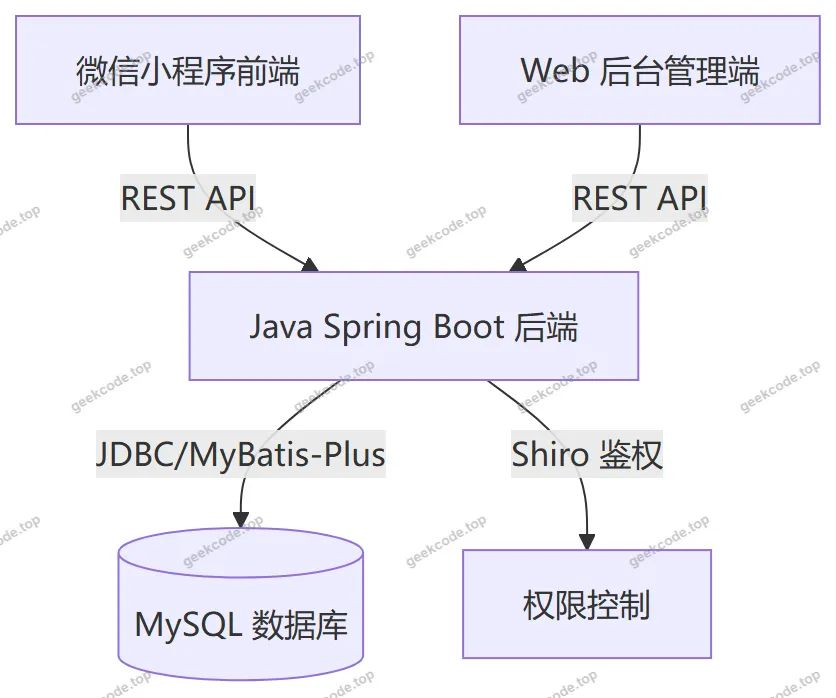</a>

<h2>功能模块</h2>

根据代码上下文中的 Controller 列表、路由配置及截图功能点，系统功能模块划分如下：

<h3>1. 小程序用户端功能</h3>
<ul>
<li><strong>首页展示</strong>：展示系统简介、公告信息及推荐的美食店铺入口。</li>
<li><strong>美食店铺浏览</strong>：查看店铺详情、地理位置及评分等信息。</li>
<li><strong>菜品信息管理</strong>：按分类浏览菜品，查看菜品图片、价格及描述；支持菜品搜索。</li>
<li><strong>购物车管理</strong>：添加菜品至购物车，修改数量，删除商品，计算总价。</li>
<li><strong>订单中心</strong>：</li>
<li><strong>确认订单</strong>：选择收货地址，确认购买明细。</li>
<li><strong>我的订单</strong>：查看历史订单状态（待支付、已完成等），查看物流信息（logistics）。</li>
<li><strong>个人中心</strong>：</li>
<li><strong>登录/注册</strong>：用户身份验证。</li>
<li><strong>个人信息</strong>：编辑头像、昵称、联系方式等。</li>
<li><strong>收货地址</strong>：新增、修改、删除及设置默认收货地址。</li>
<li><strong>我的收藏</strong>：查看已收藏的菜品或店铺列表。</li>
<li><strong>账户充值</strong>：执行 payconfirm 流程，增加账户余额。</li>
</ul>
<h3>2. Web 后台管理端功能</h3>

后台管理系统主要面向管理员，用于维护平台基础数据和业务逻辑。

<ul>
<li><strong>系统管理</strong>：</li>
<li><strong>用户管理</strong> (/yonghu)：查看、编辑、禁用注册用户信息。</li>
<li><strong>系统简介</strong> (/systemintro)：编辑平台介绍内容。</li>
<li><strong>关于我们</strong> (/aboutus)：维护关于公司的详细信息。</li>
<li><strong>配置管理</strong> (/config)：修改系统全局参数配置。</li>
<li><strong>内容管理</strong>：</li>
<li><strong>公告信息</strong> (/news)：发布、编辑、删除平台公告。</li>
<li><strong>标签管理</strong> (/biaoqian)：定义和管理菜品或店铺的标签体系。</li>
<li><strong>业务数据管理</strong>：</li>
<li><strong>美食店铺</strong> (/meishidianpu)：录入、审核、编辑店铺基本信息。</li>
<li><strong>菜品分类</strong> (/caipinfenlei)：管理菜品的分类目录。</li>
<li><strong>菜品信息</strong> (/caipinxinxi)：上架、下架、编辑具体菜品的图文及价格信息。</li>
<li><strong>订单管理</strong> (/orders/:status)：查看所有订单，按状态筛选，处理异常订单。</li>
<li><strong>收藏记录</strong> (/storeup)：查看用户的收藏数据。</li>
</ul>
<h2>用户角色与权限</h2>

系统主要包含两类角色：<strong>普通用户</strong>和<strong>管理员</strong>。

<h3>1. 普通用户 (小程序端)</h3>
<ul>
<li><strong>权限范围</strong>：仅限在微信小程序内进行消费相关操作。</li>
<li><strong>具体权限</strong>：</li>
<li>浏览所有公开的店铺、菜品、公告及标签信息。</li>
<li>注册账号并登录。</li>
<li>管理个人基本信息和收货地址。</li>
<li>进行菜品收藏、加入购物车、下单支付及查看自己的订单状态。</li>
<li>进行账户充值操作。</li>
<li><strong>限制</strong>：无法访问后台管理接口，无法修改他人数据，无法发布或编辑公共内容（如公告、菜品信息）。</li>
</ul>
<h3>2. 管理员 (Web 后台端)</h3>
<ul>
<li><strong>权限范围</strong>：拥有系统最高权限，负责平台内容的维护与数据的监控。</li>
<li><strong>具体权限</strong>：</li>
<li>登录 Web 后台管理系统。</li>
<li><strong>CRUD 操作</strong>：对美食店铺、菜品信息、菜品分类、标签、公告、关于我们、系统简介等数据进行增删改查。</li>
<li><strong>用户管理</strong>：查看和管理注册用户的信息（如重置密码、冻结账号等，具体视 Controller 实现而定，此处基于 yonghu 路由推断具备管理权）。</li>
<li><strong>订单监管</strong>：查看全部订单记录，监控交易状态。</li>
<li><strong>系统配置</strong>：修改系统基础配置参数。</li>
<li><strong>限制</strong>：通常不直接参与前台的购物行为，专注于管理与维护。</li>
</ul>
<h2>项目特色与创新点</h2>
<ol>
<li><strong>双端协同架构</strong>：项目创新性地结合了轻量级的微信小程序前端与功能完备的 Web 后台管理端。小程序侧注重用户体验与移动端便捷性，后台侧注重数据治理与业务管控，形成了完整的闭环生态。</li>
<li><strong>模块化数据管理</strong>：通过引入“标签”（Biaoqian）和“分类”（Caipinfenlei）机制，实现了美食信息的精细化多维管理。相比传统的单一分类，标签系统允许更灵活的检索与推荐场景，提升了用户发现心仪美食的效率。</li>
<li><strong>完整电商链路模拟</strong>：尽管是毕业设计项目，但实现了从“浏览-搜索-收藏-加购-下单-支付(充值)-订单跟踪”的全流程功能。特别是引入了“账户充值”概念，简化了第三方支付对接的复杂性，同时保留了资金流转的业务逻辑完整性。</li>
<li><strong>标准化技术选型</strong>：采用 Spring Boot + MyBatis-Plus + Shiro 的经典组合，保证了后端代码的高内聚低耦合，易于扩展和维护。Shiro 的引入为多角色权限控制提供了成熟的安全解决方案，符合企业级开发规范。</li>
</ol>
<h2>部署环境</h2>

为了确保项目的正常运行，需要准备以下软硬件环境：

<strong>1. 硬件环境</strong>

<ul>
<li>PC 机一台（建议内存 8GB 以上，硬盘空间充足）。</li>
<li>智能手机一部（用于真机调试微信小程序）。</li>
</ul>

<strong>2. 软件环境</strong>

<ul>
<li><strong>操作系统</strong>：Windows 10/11 或 macOS。</li>
<li><strong>Java 运行环境</strong>：JDK 1.8 或 JDK 11（需与 pom.xml 中配置的版本一致）。</li>
<li><strong>数据库</strong>：MySQL 5.7 或 MySQL 8.0。需创建对应数据库并导入 SQL 脚本。</li>
<li><strong>开发工具</strong>：</li>
<li><strong>后端开发</strong>：IntelliJ IDEA 或 Eclipse。</li>
<li><strong>前端开发</strong>：Visual Studio Code 或 HBuilderX（用于 Vue 代码编写）。</li>
<li><strong>小程序调试</strong>：微信开发者工具（WeChat DevTools）。</li>
<li><strong>构建工具</strong>：Maven（用于管理 Java 依赖及打包）。</li>
<li><strong>Node.js</strong>：若前端工程涉及 npm 包管理，需安装 Node.js（建议 LTS 版本）。</li>
</ul>

<strong>3. 配置要求</strong>

<ul>
<li>需在 <code>application.yml</code> 或 <code>application.properties</code> 中正确配置 MySQL 连接 URL、用户名和密码。</li>
<li>需配置 Shiro 的相关密钥及会话超时时间。</li>
<li>小程序前端需配置正确的后端 API 基础路径（Base URL），并确保服务器端口（默认为 8080）未被占用且防火墙放行。</li>
</ul>
<h2>五、技术特性</h2>
<ul>
<li>前后端集成部署，前端资源打包至后端 static 目录</li>
<li>使用 MyBatis-Plus 简化数据访问层开发</li>
<li>集成 Shiro 权限框架实现角色权限控制</li>
</ul>
<h2>六、功能模块截图</h2>
<h3>微信小程序用户端</h3>

<figure><a href="https://geekcode.top/archives/%E5%9F%BA%E4%BA%8E%E5%BE%AE%E4%BF%A1%E5%B0%8F%E7%A8%8B%E5%BA%8F%E7%9A%84%E5%91%A8%E8%BE%B9%E7%BE%8E%E9%A3%9F%E6%8E%A8%E8%8D%90%E7%B3%BB%E7%BB%9F2axo8?utm_source=github" title="查看完整源码">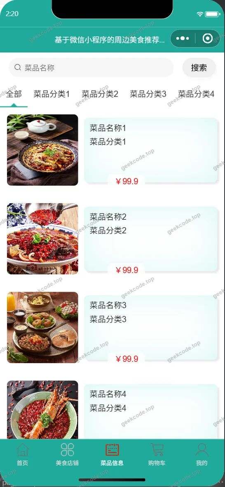</a><figcaption>小程序-菜品信息</figcaption></figure>
<figure><figcaption>小程序-登录</figcaption></figure>
<figure><a href="https://geekcode.top/archives/%E5%9F%BA%E4%BA%8E%E5%BE%AE%E4%BF%A1%E5%B0%8F%E7%A8%8B%E5%BA%8F%E7%9A%84%E5%91%A8%E8%BE%B9%E7%BE%8E%E9%A3%9F%E6%8E%A8%E8%8D%90%E7%B3%BB%E7%BB%9F2axo8?utm_source=github" title="查看完整源码">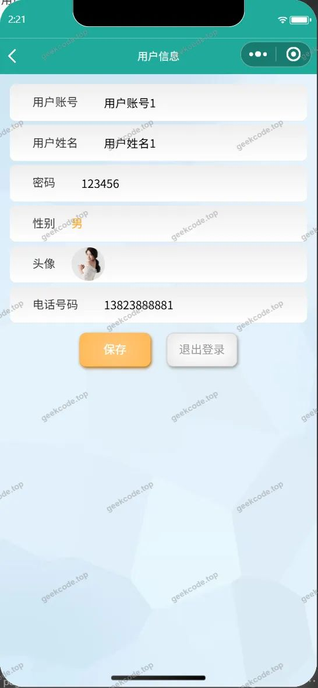</a><figcaption>小程序-个人信息</figcaption></figure>
<figure><a href="https://geekcode.top/archives/%E5%9F%BA%E4%BA%8E%E5%BE%AE%E4%BF%A1%E5%B0%8F%E7%A8%8B%E5%BA%8F%E7%9A%84%E5%91%A8%E8%BE%B9%E7%BE%8E%E9%A3%9F%E6%8E%A8%E8%8D%90%E7%B3%BB%E7%BB%9F2axo8?utm_source=github" title="查看完整源码">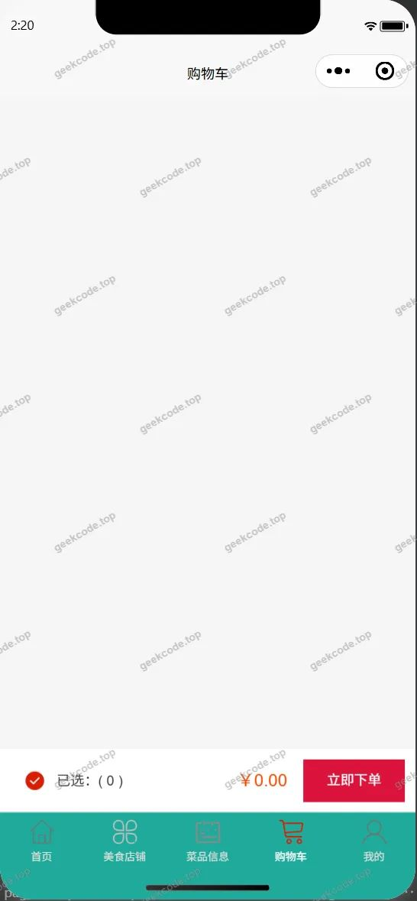</a><figcaption>小程序-购物车</figcaption></figure>
<figure><a href="https://geekcode.top/archives/%E5%9F%BA%E4%BA%8E%E5%BE%AE%E4%BF%A1%E5%B0%8F%E7%A8%8B%E5%BA%8F%E7%9A%84%E5%91%A8%E8%BE%B9%E7%BE%8E%E9%A3%9F%E6%8E%A8%E8%8D%90%E7%B3%BB%E7%BB%9F2axo8?utm_source=github" title="查看完整源码">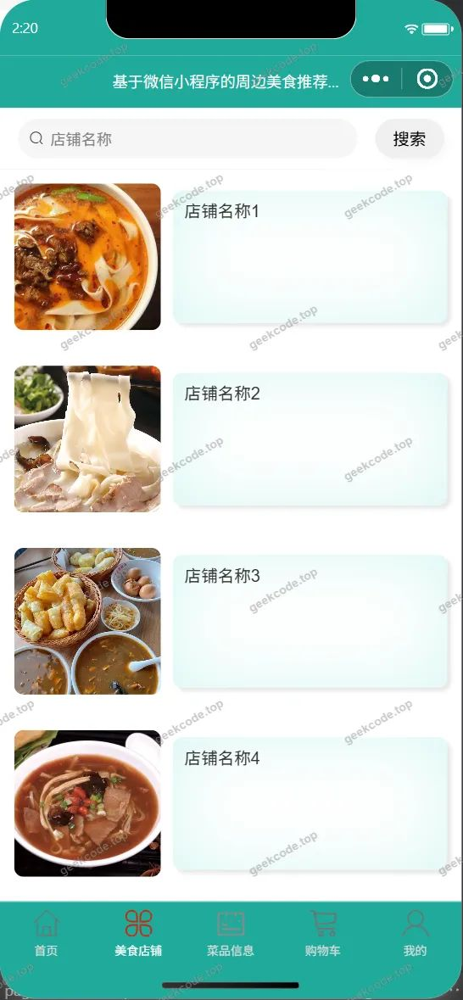</a><figcaption>小程序-美食店铺</figcaption></figure>
<figure><figcaption>小程序-确认订单</figcaption></figure>
<figure><a href="https://geekcode.top/archives/%E5%9F%BA%E4%BA%8E%E5%BE%AE%E4%BF%A1%E5%B0%8F%E7%A8%8B%E5%BA%8F%E7%9A%84%E5%91%A8%E8%BE%B9%E7%BE%8E%E9%A3%9F%E6%8E%A8%E8%8D%90%E7%B3%BB%E7%BB%9F2axo8?utm_source=github" title="查看完整源码">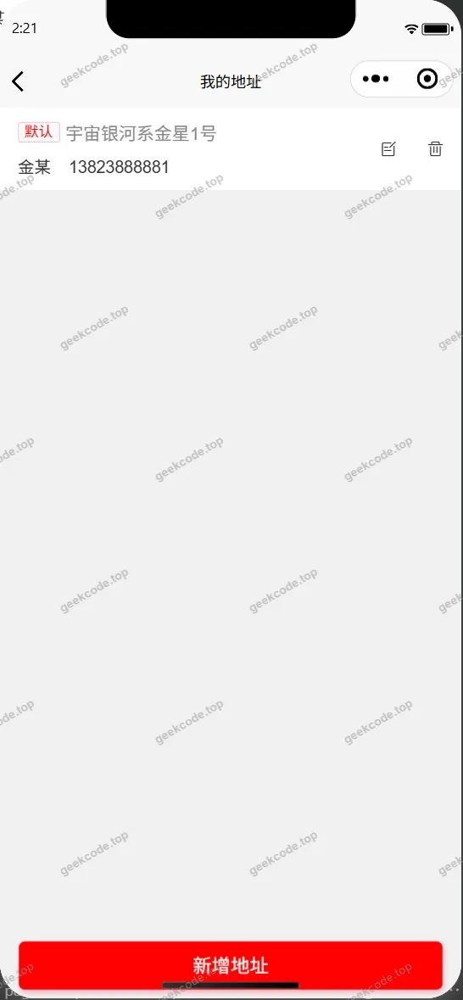</a><figcaption>小程序-收货地址</figcaption></figure>
<figure><a href="https://geekcode.top/archives/%E5%9F%BA%E4%BA%8E%E5%BE%AE%E4%BF%A1%E5%B0%8F%E7%A8%8B%E5%BA%8F%E7%9A%84%E5%91%A8%E8%BE%B9%E7%BE%8E%E9%A3%9F%E6%8E%A8%E8%8D%90%E7%B3%BB%E7%BB%9F2axo8?utm_source=github" title="查看完整源码">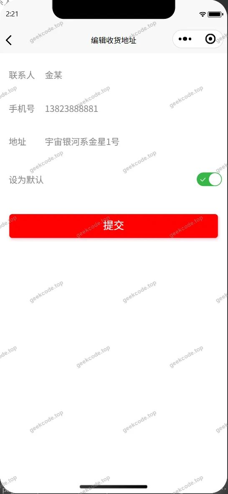</a><figcaption>小程序-收货地址详情</figcaption></figure>
<figure><figcaption>小程序-首页</figcaption></figure>
<figure><a href="https://geekcode.top/archives/%E5%9F%BA%E4%BA%8E%E5%BE%AE%E4%BF%A1%E5%B0%8F%E7%A8%8B%E5%BA%8F%E7%9A%84%E5%91%A8%E8%BE%B9%E7%BE%8E%E9%A3%9F%E6%8E%A8%E8%8D%90%E7%B3%BB%E7%BB%9F2axo8?utm_source=github" title="查看完整源码">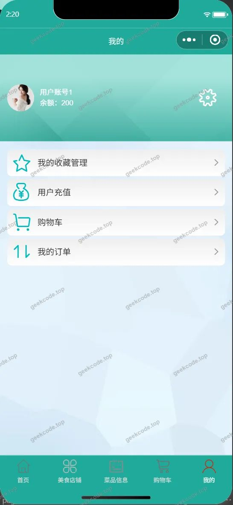</a><figcaption>小程序-我的</figcaption></figure>
<figure><figcaption>小程序-我的订单</figcaption></figure>
<figure><figcaption>小程序-我的订单logistics</figcaption></figure>
<figure><figcaption>小程序-我的收藏列表</figcaption></figure>
<figure><a href="https://geekcode.top/archives/%E5%9F%BA%E4%BA%8E%E5%BE%AE%E4%BF%A1%E5%B0%8F%E7%A8%8B%E5%BA%8F%E7%9A%84%E5%91%A8%E8%BE%B9%E7%BE%8E%E9%A3%9F%E6%8E%A8%E8%8D%90%E7%B3%BB%E7%BB%9F2axo8?utm_source=github" title="查看完整源码">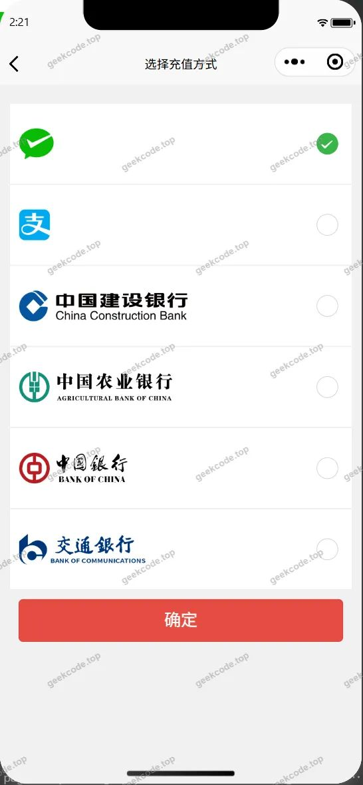</a><figcaption>小程序-账户充值payconfirm</figcaption></figure>
<figure><a href="https://geekcode.top/archives/%E5%9F%BA%E4%BA%8E%E5%BE%AE%E4%BF%A1%E5%B0%8F%E7%A8%8B%E5%BA%8F%E7%9A%84%E5%91%A8%E8%BE%B9%E7%BE%8E%E9%A3%9F%E6%8E%A8%E8%8D%90%E7%B3%BB%E7%BB%9F2axo8?utm_source=github" title="查看完整源码">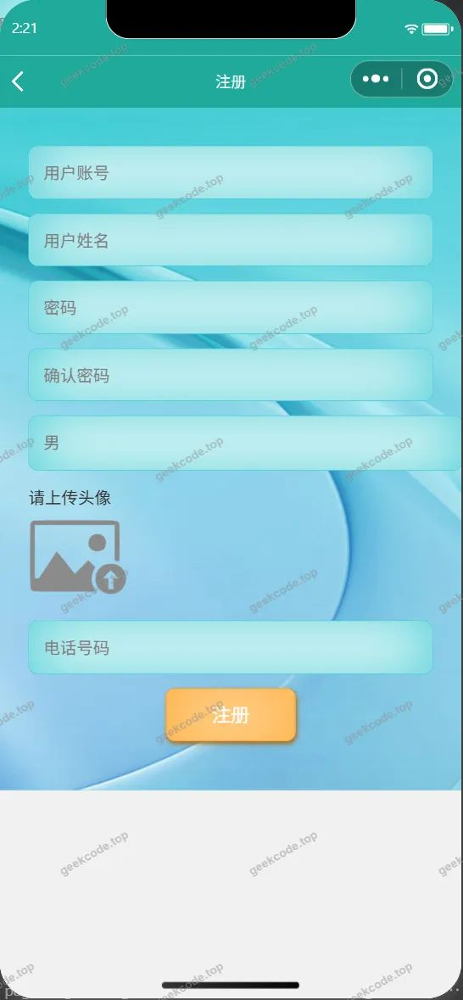</a><figcaption>小程序-注册</figcaption></figure>

<h3>微信小程序管理端</h3>

<figure><figcaption>小程序-管理端-标签列表</figcaption></figure>
<figure><a href="https://geekcode.top/archives/%E5%9F%BA%E4%BA%8E%E5%BE%AE%E4%BF%A1%E5%B0%8F%E7%A8%8B%E5%BA%8F%E7%9A%84%E5%91%A8%E8%BE%B9%E7%BE%8E%E9%A3%9F%E6%8E%A8%E8%8D%90%E7%B3%BB%E7%BB%9F2axo8?utm_source=github" title="查看完整源码">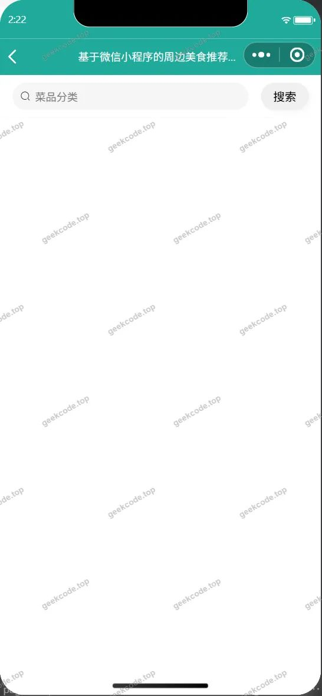</a><figcaption>小程序-管理端-菜品分类列表</figcaption></figure>
<figure><a href="https://geekcode.top/archives/%E5%9F%BA%E4%BA%8E%E5%BE%AE%E4%BF%A1%E5%B0%8F%E7%A8%8B%E5%BA%8F%E7%9A%84%E5%91%A8%E8%BE%B9%E7%BE%8E%E9%A3%9F%E6%8E%A8%E8%8D%90%E7%B3%BB%E7%BB%9F2axo8?utm_source=github" title="查看完整源码">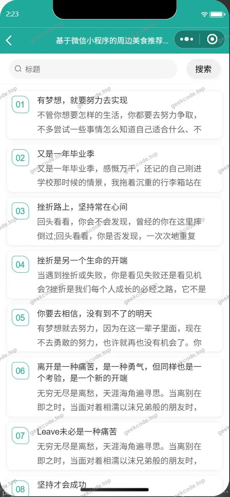</a><figcaption>小程序-管理端-公告信息列表</figcaption></figure>
<figure><figcaption>小程序-管理端-关于我们列表</figcaption></figure>
<figure><figcaption>小程序-管理端-系统简介列表</figcaption></figure>
<figure><figcaption>小程序-管理端-用户列表</figcaption></figure>

<h3>后台管理端</h3>
<h4>后台-标签</h4>

<a href="https://geekcode.top/archives/%E5%9F%BA%E4%BA%8E%E5%BE%AE%E4%BF%A1%E5%B0%8F%E7%A8%8B%E5%BA%8F%E7%9A%84%E5%91%A8%E8%BE%B9%E7%BE%8E%E9%A3%9F%E6%8E%A8%E8%8D%90%E7%B3%BB%E7%BB%9F2axo8?utm_source=github" title="查看完整源码">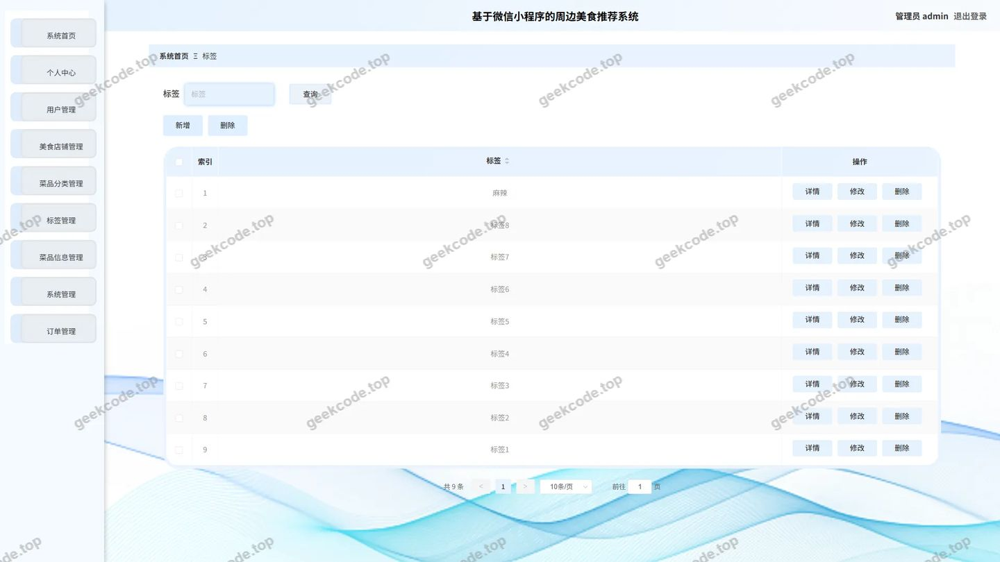</a>

<h4>后台-登录页</h4>

<a href="https://geekcode.top/archives/%E5%9F%BA%E4%BA%8E%E5%BE%AE%E4%BF%A1%E5%B0%8F%E7%A8%8B%E5%BA%8F%E7%9A%84%E5%91%A8%E8%BE%B9%E7%BE%8E%E9%A3%9F%E6%8E%A8%E8%8D%90%E7%B3%BB%E7%BB%9F2axo8?utm_source=github" title="查看完整源码">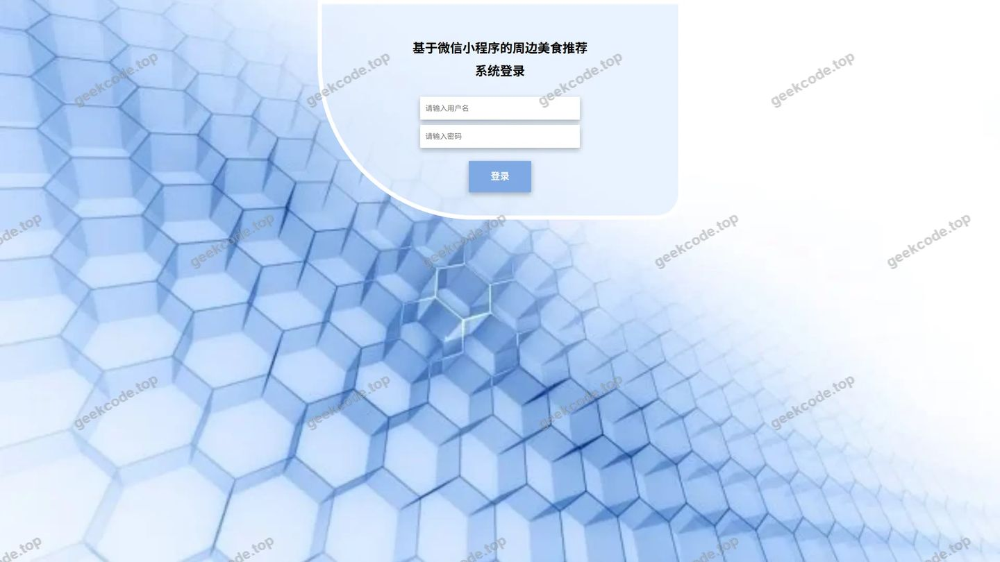</a>

<h4>后台-公告信息</h4>

<a href="https://geekcode.top/archives/%E5%9F%BA%E4%BA%8E%E5%BE%AE%E4%BF%A1%E5%B0%8F%E7%A8%8B%E5%BA%8F%E7%9A%84%E5%91%A8%E8%BE%B9%E7%BE%8E%E9%A3%9F%E6%8E%A8%E8%8D%90%E7%B3%BB%E7%BB%9F2axo8?utm_source=github" title="查看完整源码">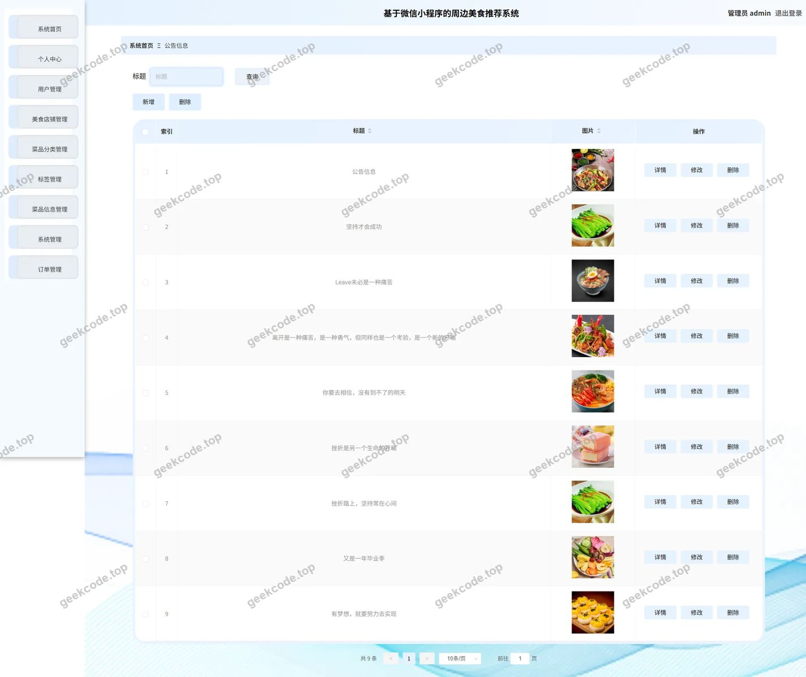</a>

<h4>后台-关于我们</h4>

<a href="https://geekcode.top/archives/%E5%9F%BA%E4%BA%8E%E5%BE%AE%E4%BF%A1%E5%B0%8F%E7%A8%8B%E5%BA%8F%E7%9A%84%E5%91%A8%E8%BE%B9%E7%BE%8E%E9%A3%9F%E6%8E%A8%E8%8D%90%E7%B3%BB%E7%BB%9F2axo8?utm_source=github" title="查看完整源码">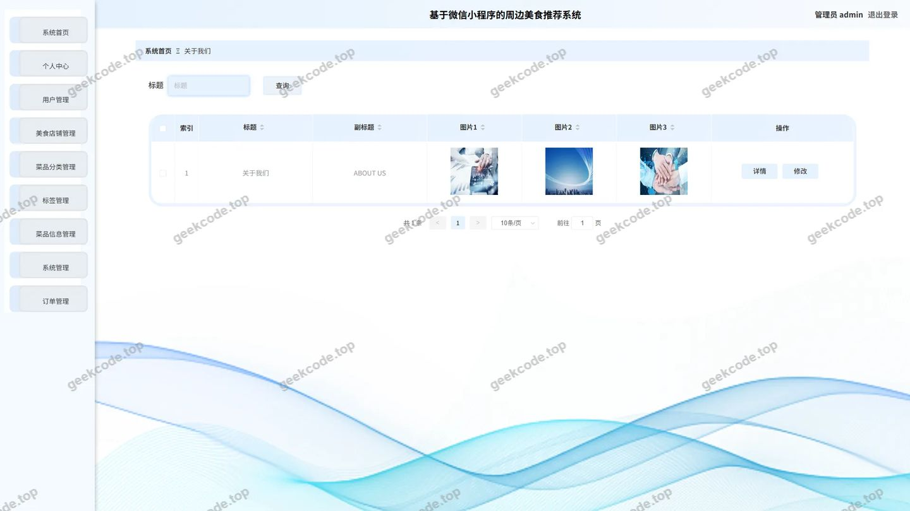</a>

<h4>后台-美食店铺</h4>

<a href="https://geekcode.top/archives/%E5%9F%BA%E4%BA%8E%E5%BE%AE%E4%BF%A1%E5%B0%8F%E7%A8%8B%E5%BA%8F%E7%9A%84%E5%91%A8%E8%BE%B9%E7%BE%8E%E9%A3%9F%E6%8E%A8%E8%8D%90%E7%B3%BB%E7%BB%9F2axo8?utm_source=github" title="查看完整源码">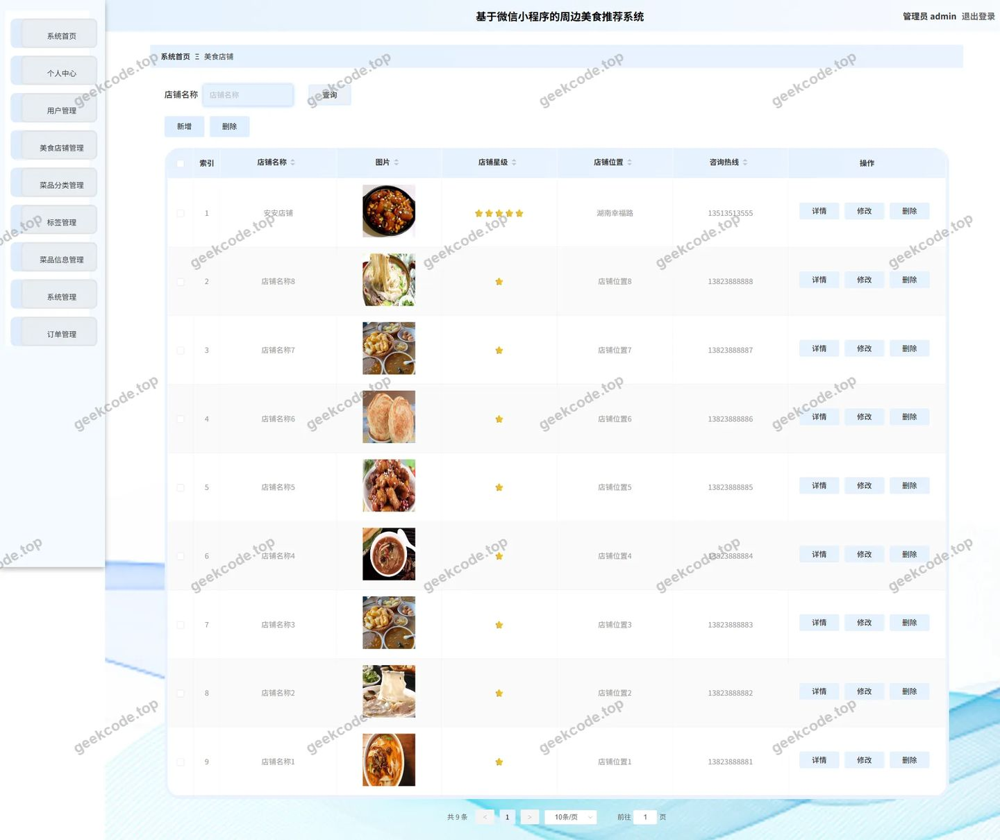</a>

<h4>后台首页</h4>

<a href="https://geekcode.top/archives/%E5%9F%BA%E4%BA%8E%E5%BE%AE%E4%BF%A1%E5%B0%8F%E7%A8%8B%E5%BA%8F%E7%9A%84%E5%91%A8%E8%BE%B9%E7%BE%8E%E9%A3%9F%E6%8E%A8%E8%8D%90%E7%B3%BB%E7%BB%9F2axo8?utm_source=github" title="查看完整源码">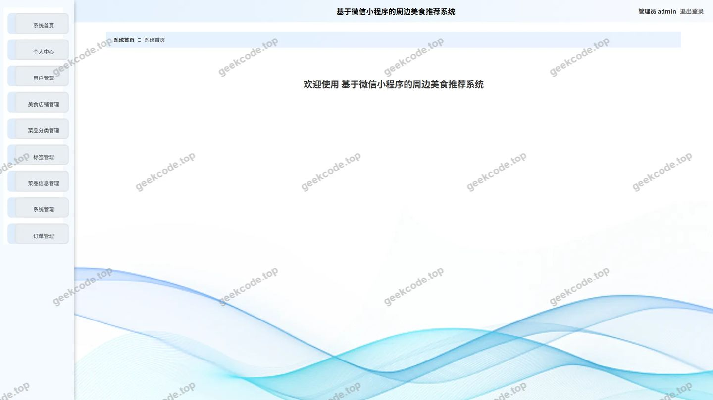</a>

<h4>后台-用户</h4>

<a href="https://geekcode.top/archives/%E5%9F%BA%E4%BA%8E%E5%BE%AE%E4%BF%A1%E5%B0%8F%E7%A8%8B%E5%BA%8F%E7%9A%84%E5%91%A8%E8%BE%B9%E7%BE%8E%E9%A3%9F%E6%8E%A8%E8%8D%90%E7%B3%BB%E7%BB%9F2axo8?utm_source=github" title="查看完整源码">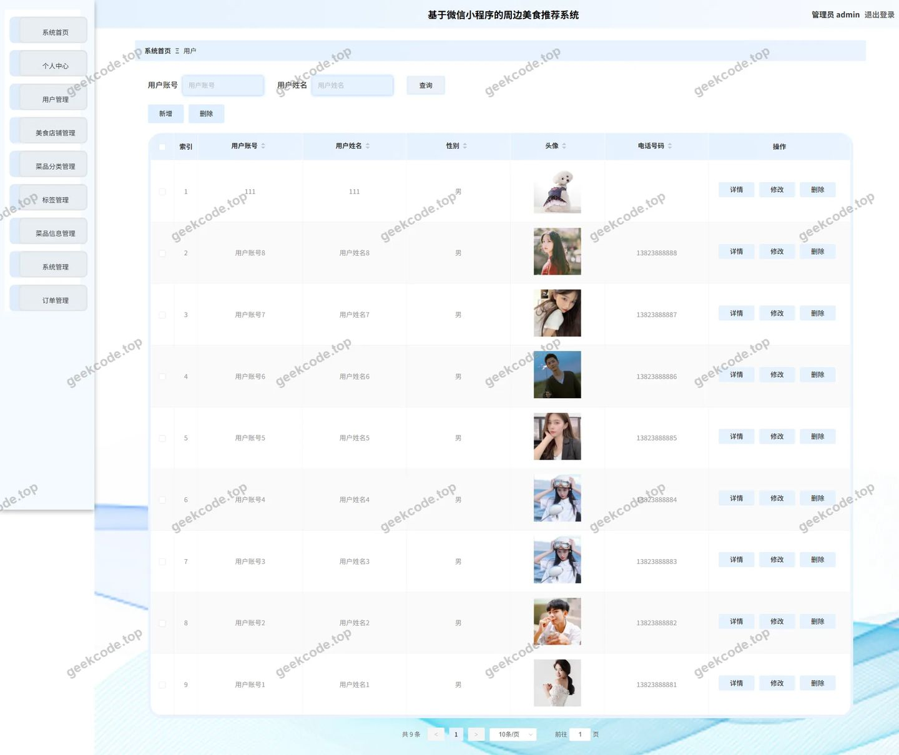</a>

<h4>后台-关于我们</h4>

<a href="https://geekcode.top/archives/%E5%9F%BA%E4%BA%8E%E5%BE%AE%E4%BF%A1%E5%B0%8F%E7%A8%8B%E5%BA%8F%E7%9A%84%E5%91%A8%E8%BE%B9%E7%BE%8E%E9%A3%9F%E6%8E%A8%E8%8D%90%E7%B3%BB%E7%BB%9F2axo8?utm_source=github" title="查看完整源码">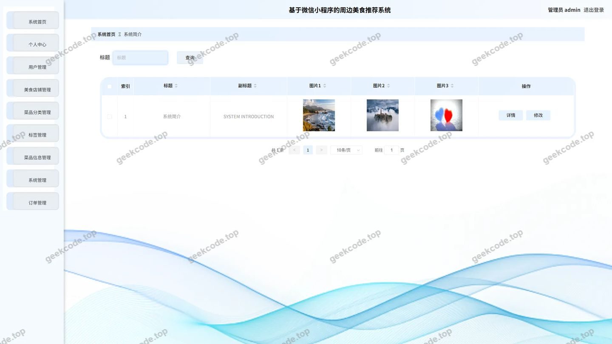</a>

---

## 获取完整源码

| 项目 | 说明 |
| --- | --- |
| 项目名 | 基于微信小程序的周边美食推荐系统2axo8 |
| 运行截图 | 本文 30 张（站点带水印原图，仓库 `images/` 目录） |
| 完整源码 | [https://geekcode.top/archives/%E5%9F%BA%E4%BA%8E%E5%BE%AE%E4%BF%A1%E5%B0%8F%E7%A8%8B%E5%BA%8F%E7%9A%84%E5%91%A8%E8%BE%B9%E7%BE%8E%E9%A3%9F%E6%8E%A8%E8%8D%90%E7%B3%BB%E7%BB%9F2axo8?utm_source=github](https://geekcode.top/archives/%E5%9F%BA%E4%BA%8E%E5%BE%AE%E4%BF%A1%E5%B0%8F%E7%A8%8B%E5%BA%8F%E7%9A%84%E5%91%A8%E8%BE%B9%E7%BE%8E%E9%A3%9F%E6%8E%A8%E8%8D%90%E7%B3%BB%E7%BB%9F2axo8?utm_source=github) |
| 咨询微信 | **ir9372**（备注：jingpin-yuanma） |
| 更多项目 | [极客代码 geekcode.top](https://geekcode.top/?utm_source=github) |

> 需要源码、部署、改配置、跑不起来等问题，加微信 ir9372 沟通，说明项目名即可。
